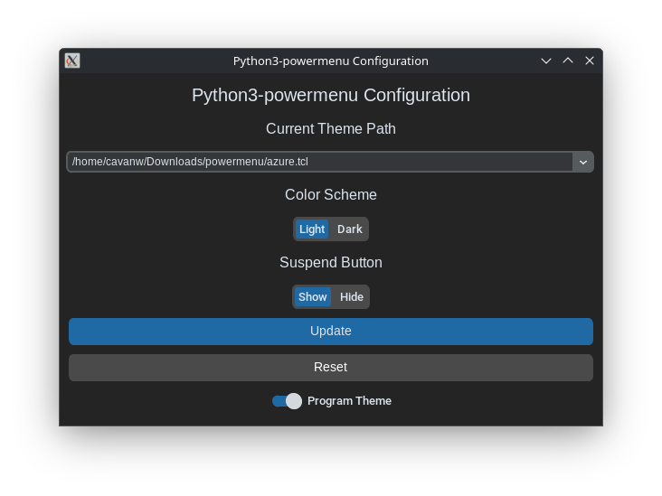

# python3-powermenu-config
_python3-powermenu-config_ is a simple GUI configuration utility for my project, python3-powermenu.

## Dependencies
|Dependencies|Website|
| ----------- | --- |
|python3 >= 3.7|[https://www.python.org](https://www.python.org)|
|python3-tk|[https://www.python.org](https://www.python.org)|
|CustomTkinter|[https://customtkinter.tomschimansky.com/](https://customtkinter.tomschimansky.com/)|
|python3-powermenu|[https://github.com/crazycatlover98544/python3-powermenu/](https://github.com/crazycatlover98544/python3-powermenu/)|

CustomTkinter is not found in standard Debian repositories (it may be found in others), so you will likely need to create a venv. If you do not know how to do this, then you can look it up. There are many guides that instruct you on how to create a venv.

## Screenshot

(Screenshot taken in dark mode, this program also has a light mode)

## Extra Information
`yesno.py` is a helper script that has a custom dialogue for Yes/No prompts, as tkinter's default does not look the best on modern linux with a desktop environment like KDE or GNOME. This program depends on that helper script, and will error out without it. Before opening an issue, be sure you have `yesno.py` in the same directory as this program, or installed as a python3 module.

## License
This program is licensed under the MIT license. To view this license, open up LICENSE or go to the following URL: [https://opensource.org/license/mit](https://opensource.org/license/mit)
